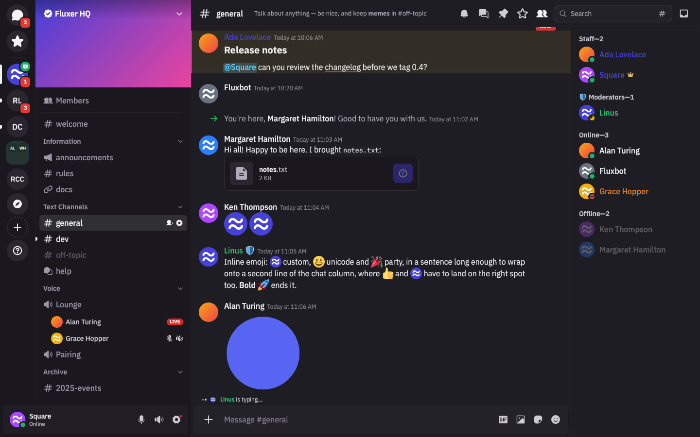
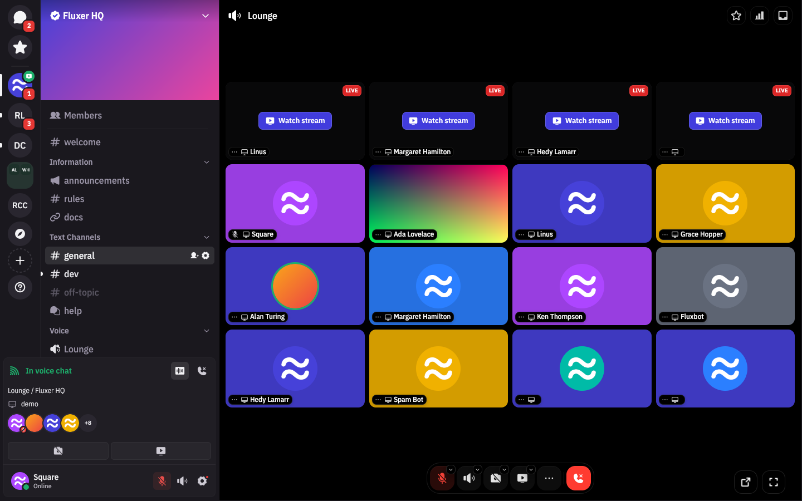
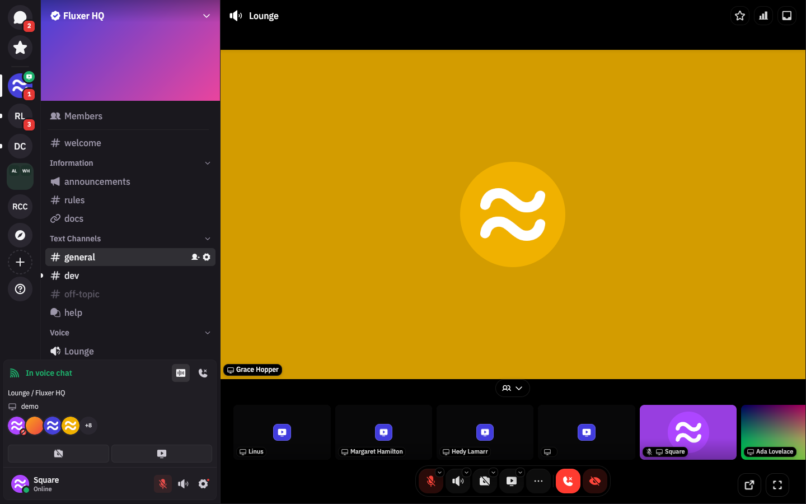
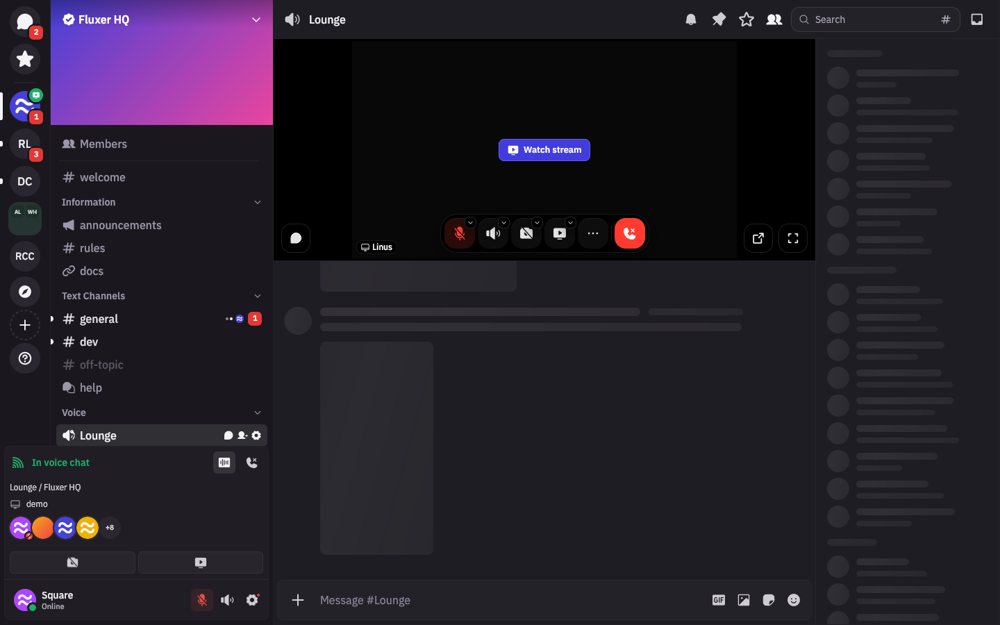
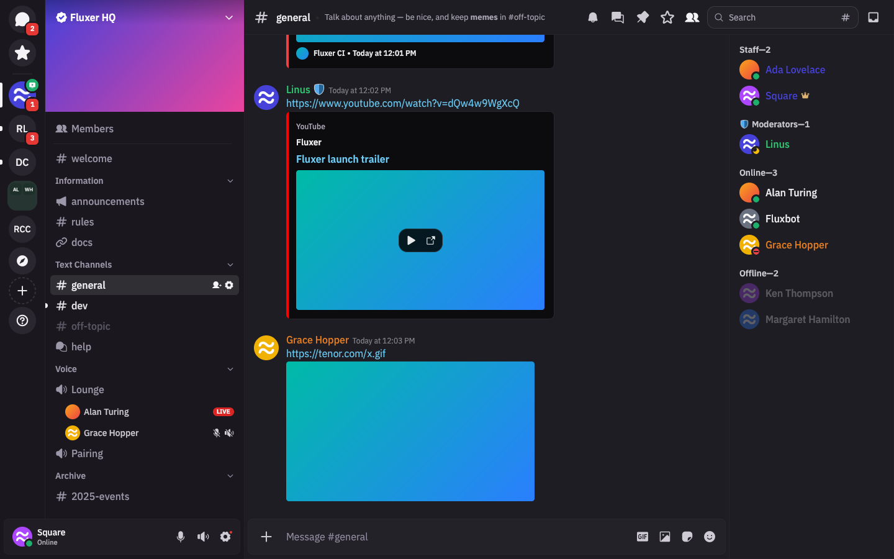
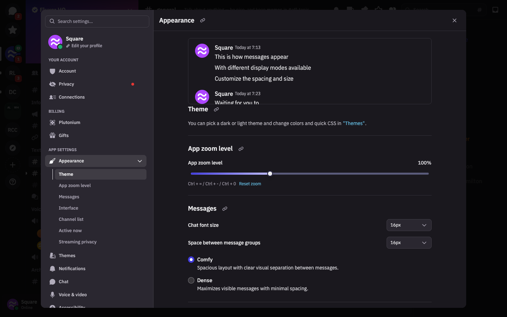
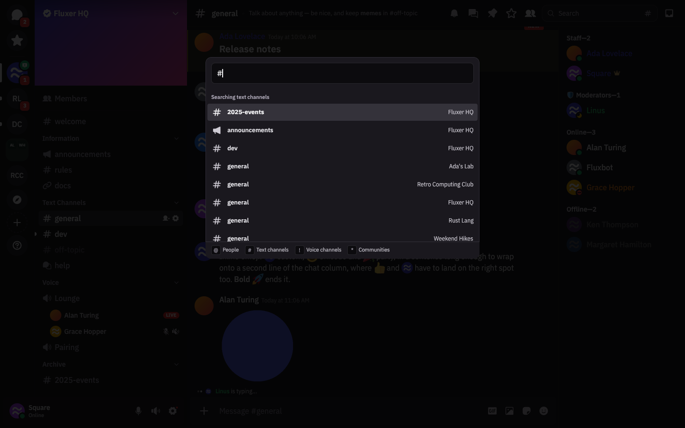
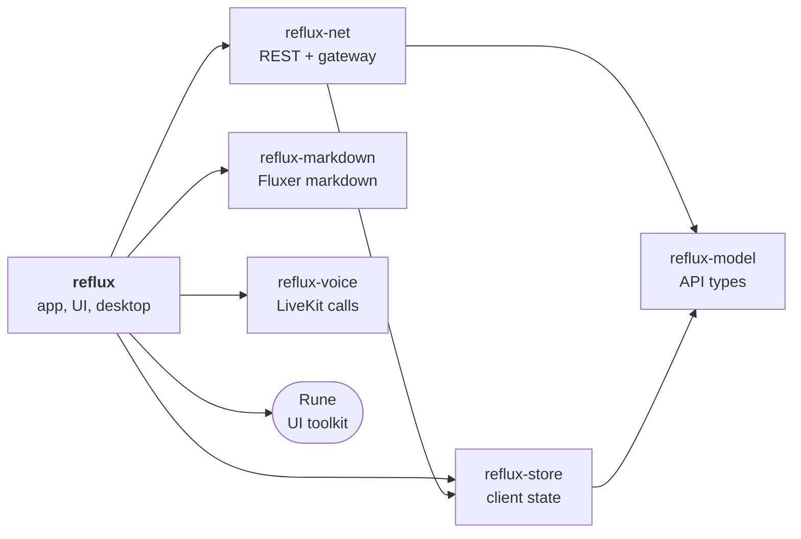

<div align="center">


# Reflux

**A native [Fluxer](https://github.com/fluxerapp/fluxer) desktop client, written in Rust on [Rune](https://github.com/anomalyco/rune).**<br>
Fluxer's look and behaviour, screen for screen, without a browser engine.

[](LICENSE)
[](https://www.rust-lang.org)
[](https://github.com/anomalyco/rune)

[](https://github.com/square3ang/reflux/commits/master)

[Screenshots](#screenshots) · [Features](#features) · [Building](#building) · [Running](#running) · [Development](#development)



</div>

> [!NOTE]
> Reflux is **unofficial** and is not made or endorsed by the Fluxer team. It works with any
> Fluxer instance through the same API and gateway as the official client.

## Screenshots

<table>
  <tr>
    <td width="50%"><br><sub><b>Voice and video</b>: the call grid with live streams</sub></td>
    <td width="50%"><br><sub><b>Focus layout</b>: a pinned tile over the members row</sub></td>
  </tr>
  <tr>
    <td><br><sub><b>Compact call</b>: the call strip above the channel's chat (still loading here)</sub></td>
    <td><br><sub><b>Embeds</b>: rich embeds, YouTube and GIFs</sub></td>
  </tr>
  <tr>
    <td><br><sub><b>Settings</b>: the open tab's sections listed in the sidebar, following the scroll</sub></td>
    <td><br><sub><b>Quick switcher</b>: <kbd>Ctrl</kbd> + <kbd>K</kbd> across people, channels and communities</sub></td>
  </tr>
</table>

<sub>Rendered from the built-in demo scenes (<code>--shell-demo</code>), so no real accounts appear.</sub>

## Features

| | |
|---|---|
| 💬 **Chat** | Messages, replies, edits, reactions, pins, threads and forums, search, inbox, Fluxer's markdown, embeds, attachments, voice messages, emoji, stickers and GIFs |
| 🏘️ **Communities** | Channels and categories, roles and permissions, invites, moderation, activity log, emoji and sticker management, webhooks |
| 🎙️ **Voice and video** | Calls, camera, screen share with system audio, stream viewer, compact and full call views, noise suppression, push-to-talk |
| ⌨️ **Global shortcuts** | Mute, deafen and push-to-talk from anywhere: the GlobalShortcuts portal on Wayland, key hooks on X11, Windows and macOS |
| 🖥️ **Desktop** | Tray, notifications, dock badge, autostart, `fluxer://` links, single instance, several accounts at once, offline cache |
| 🎨 **Look** | Themes and Quick CSS variables, zoom, reduced motion, right-to-left languages, Fluxer Sans in every script |

Progress is tracked row by row against the official app in **[docs/FEATURES.md](docs/FEATURES.md)**.
Where Reflux has to differ, and why, is listed in **[docs/WORKAROUNDS.md](docs/WORKAROUNDS.md)**.

> [!IMPORTANT]
> **Not supported:** inline YouTube playback (the play button opens the browser; Rune has no web
> view yet, [anomalyco/rune#412](https://github.com/anomalyco/rune/issues/412)), billing and checkout
> (opened in the browser), and camera background effects.

### Platforms

| Platform | State |
|---|---|
| 🐧 **Linux** | Daily driver. KDE Plasma 6 on Wayland is the main test bed; X11 works |
| 🪟 **Windows** | Builds and is checked; less runtime testing |
| 🍎 **macOS** | Builds and is checked; less runtime testing |

## Building

You need stable Rust (edition 2024) and a C/C++ toolchain.

<details>
<summary><b>🐧 Linux packages</b></summary>

<br>

| What | For | Packages (Arch names) |
|---|---|---|
| GStreamer 1.x + headers | inline video, the camera | `gstreamer` `gst-plugins-base` `gst-plugins-good` `gst-libav` |
| PipeWire or PulseAudio | call audio and devices | `pipewire-pulse` or `pulseaudio` |
| Secret Service | storing the session token | KWallet or GNOME Keyring |
| D-Bus + xdg-desktop-portal | notifications, file pickers, global shortcuts, screen share | `xdg-desktop-portal` + your desktop's backend |

Other distributions use similar names (`libgstreamer1.0-dev` and friends on Debian/Ubuntu).

</details>

```sh
cargo build --release -p reflux
./target/release/reflux
```

> [!TIP]
> The first build compiles libwebrtc through LiveKit and takes a while. For UI work without
> voice, camera or screen share there is a much faster build:
>
> ```sh
> scripts/fast-build.sh    # --no-default-features --features gst
> ```
>
> `--no-default-features` alone also drops GStreamer; attachments then open in the browser.

<details>
<summary><b>🔤 Fonts for CJK, Arabic, Hebrew, Devanagari and Thai</b></summary>

<br>

The Latin faces of Fluxer Sans are built into the binary. The other scripts' faces are loaded
from a `fonts` folder beside the binary (or `assets/fonts` in a checkout); without them those
scripts fall back to system fonts. Build them from Fluxer's font package:

```sh
python3 scripts/fonts-extract.py <fluxer>/packages/fonts/files
```

</details>

## Running

Sign in with your instance's address, or bring over the official desktop app's session:

```sh
reflux --import-fluxer-session
```

<details>
<summary><b>🐧 Desktop entry and <code>fluxer://</code> links on Linux</b></summary>

<br>

```sh
cp packaging/reflux.desktop ~/.local/share/applications/
xdg-mime default reflux.desktop x-scheme-handler/fluxer
```

</details>

<details>
<summary><b>⌨️ Global shortcuts on Wayland</b></summary>

<br>

Shortcuts go through the desktop's GlobalShortcuts portal, which asks you to confirm the keys
once. On KDE, changing a voice keybind in the app updates the system shortcut too; elsewhere,
change it in the desktop's shortcut settings.

</details>

<details>
<summary><b>🛠️ Environment variables</b></summary>

<br>

| Variable | Effect |
|---|---|
| `REFLUX_CONFIG_DIR` | Use another config directory (a separate profile) |
| `REFLUX_NO_KEYRING` | Keep the session in the config file instead of the keyring |
| `REFLUX_DEBUG_SCROLL` | Log message list offsets |
| `REFLUX_DEBUG_WHEEL` | Log wheel events |

</details>

## Development

```sh
cargo test -p reflux -p reflux-voice
cargo clippy -p reflux
scripts/cross-check.sh                # cargo check for the Windows and macOS targets
```

Most screens have offline demo scenes that render straight to an image, with no server:

```sh
reflux --shell-demo --voice=call-crowd --snap call.png --size 1440x900
reflux --gallery                      # the component gallery
```

### Crates



| Crate | What |
|---|---|
| [`reflux`](crates/reflux) | The app: UI, settings, desktop integration |
| [`reflux-net`](crates/reflux-net) | REST and gateway client |
| [`reflux-store`](crates/reflux-store) | Client state built from gateway events |
| [`reflux-model`](crates/reflux-model) | API types |
| [`reflux-markdown`](crates/reflux-markdown) | Fluxer's markdown dialect |
| [`reflux-voice`](crates/reflux-voice) | Calls, camera and screen share over LiveKit (`stub.rs` without WebRTC) |

## License

Reflux is licensed under **[AGPL-3.0-or-later](LICENSE)**, like Fluxer.

The bundled fonts are derived from IBM Plex under the SIL Open Font License
([assets/fonts/LICENSE-IBM-PLEX.txt](assets/fonts/LICENSE-IBM-PLEX.txt)). Other third-party
assets carry their own license files next to them.
